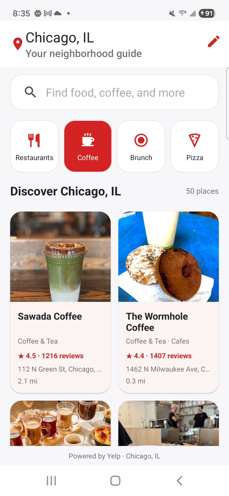
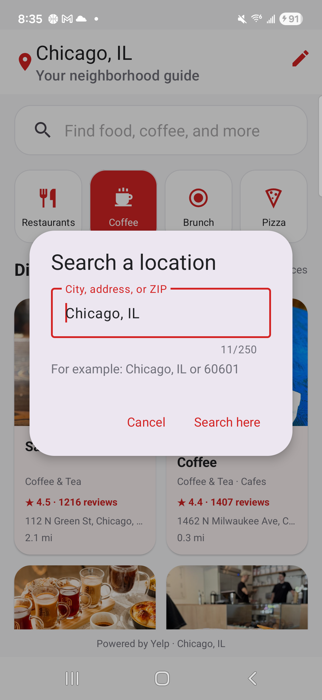
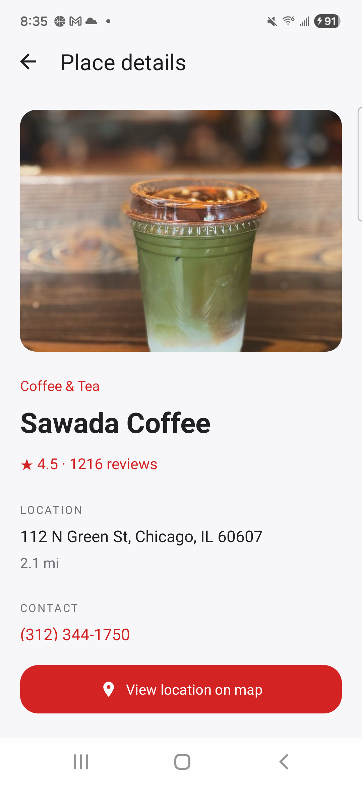
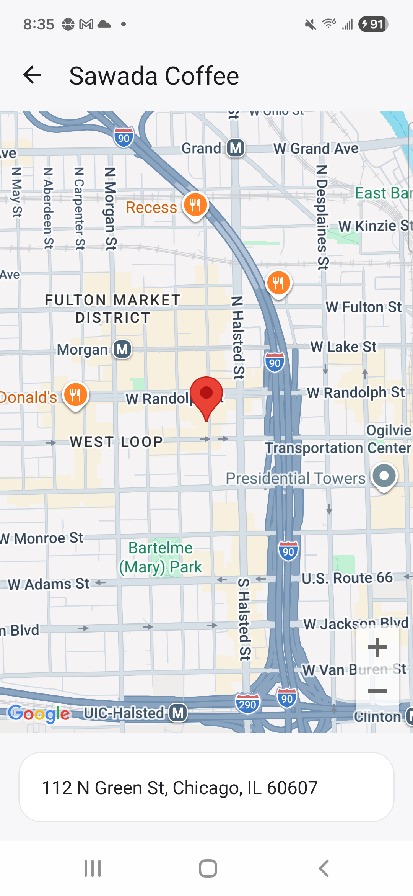

# Tampa Guide

An Android app for finding businesses by location through Yelp and viewing their locations on Google Maps.

## Screenshots

Captured from the running app on a Samsung phone using live Yelp results for Chicago and Google Maps.

| Business discovery | Change the search location |
| :---: | :---: |
|  |  |

| Business details | Google Maps |
| :---: | :---: |
|  |  |

## Run the app

1. Open the project in Android Studio with support for Android Gradle Plugin 9.4.
2. Use JDK 21 for Gradle. The app compiles to Java 17 bytecode.
3. Install Android SDK 37 and SDK Build Tools 36.0.0.
4. Copy `local.properties.example` to `local.properties`, set your Android SDK path, and add your Yelp and Google Maps keys. Environment variables named `YELP_API_KEY` and `MAPS_API_KEY` override the local values.
5. Run the `app` configuration on Android 8.0 or newer.

```sh
./gradlew :app:assembleDebug
```

The project also builds without API keys. Business search then displays a configuration message. Maps need a valid Android-restricted Maps SDK key; the map action is disabled when no key is configured. The app displays business coordinates; it does not request the device's location.

For a Maps authorization failure, enable Maps SDK for Android in the key's Google Cloud project and authorize `com.example.yelpclone` with the signing certificate used for the installed build. Obtain that certificate's SHA-1 with `./gradlew :app:signingReport`. See [Google's Android key setup guide](https://developers.google.com/maps/documentation/android-sdk/get-api-key).

Keys belong in ignored local configuration or the build environment. Values supplied to an Android build are still extractable from the APK. A published app should access Yelp through a backend that owns the Yelp credential. Keys previously committed to this repository remain in Git history and should be replaced before public distribution.

## MVVM ownership

The app has one Gradle module. Business discovery has separate presentation, domain, and data packages:

```text
com.example.yelpclone/
  presentation/
    business/              ViewModel and domain-to-presentation mapper
      model/               Screen state and Parcelable display model
      view/                Activities and list adapter
    common/                Error resources and window insets
  domain/
    business/
      model/               Business values without Android dependencies
      repository/          BusinessRepository contract
    common/                Repository outcomes and failure reasons
  data/
    business/
      model/               Yelp response records
      source/              Retrofit service
      mapper/              Response-to-domain mapping
      repository/          BusinessRepository implementation
    network/               Shared transport failure handling
  di/                      Application and Hilt composition root
```

Activities collect screen state while started and forward actions to their ViewModels. ViewModels own requests, cancel replaced requests, and map domain values before publishing state. The location header opens an editor for a city, neighborhood, address, or ZIP code. Tampa is the starting location. Changing the location repeats the current business search there; category searches and retries use that same location. The editor validates Yelp's 250-character limit and keeps its draft during screen recreation.

Submitted search input and the chosen location survive Android recreating the process through `SavedStateHandle`.

Repositories validate their boundaries, call Retrofit, and map response records into domain values. Cancellation propagates instead of becoming an error message. Domain contracts expose typed outcomes; presentation translates failures into screen errors and localized messages.

Details and maps render small presentation models passed through internal intents. Ordinary Android back navigation returns to the existing list and its ViewModel. Missing payloads close safely, and missing coordinates disable map navigation. No database or paging layer is needed for the current request-based screens.

## Formatting and checks

Kotlin source and build scripts follow `.editorconfig` and ktlint's official Kotlin style. Kotlin files have a responsibility KDoc with author and introduction date. XML uses four-space indentation and one attribute per line on longer declarations.

```sh
./gradlew formatKotlin
./gradlew checkKotlinFormat :app:testDebugUnitTest :app:lintDebug :app:assembleDebug
```

Unit tests cover source mapping, credential validation, cancellation, saved input, and retry state. Device tests cover search, error recovery, back navigation, recreation, and missing navigation payloads. Hilt replaces live repositories with deterministic fixtures during device tests.

With one emulator or device connected:

```sh
./gradlew :app:connectedDebugAndroidTest
```

When several devices are connected, select the intended one explicitly:

```sh
ANDROID_SERIAL=emulator-5554 ./gradlew :app:connectedDebugAndroidTest
```

Device tests save UI screenshots under the app's external-files `screenshots` directory. These screenshots contain test fixtures, not live business results. Live Yelp authorization, quotas, and Google Maps authorization require valid service configuration and separate verification.

GitHub Actions runs formatting checks, unit tests, lint, and a debug build without credentials. Dependency versions are in `gradle/libs.versions.toml`.

Created by Stefan Bayne.
